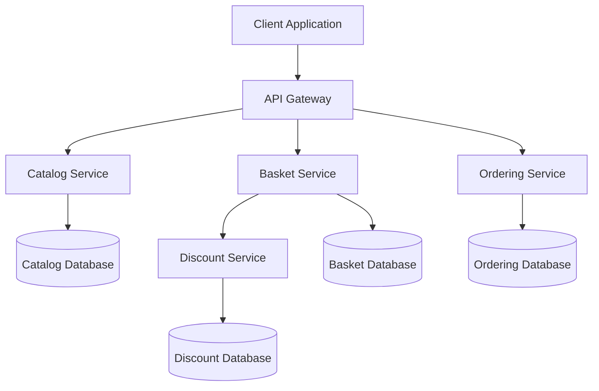

# .NET 8 Microservices Architecture

A microservices-based e-commerce application built with **.NET 8**, following the architectural principles and implementation approaches demonstrated in Mehmet Özkaya's .NET Microservices course.

The project demonstrates how to design, develop, and integrate independent microservices using modern software architecture patterns, distributed communication, containerization, and database technologies.

## Overview

The application follows a microservices architecture in which each service is responsible for a specific business capability. Services are independently developed and maintain their own data, while communicating with other services through well-defined interfaces and messaging mechanisms.

The primary goal of this project is to gain practical experience with building distributed applications using ASP.NET Core and modern microservices technologies.

## Architecture

The system consists of several independent microservices, each responsible for a specific domain.

### Microservices

| Service | Responsibility |
|---|---|
| Catalog Service | Manages product catalog information, including products, categories, and product types. |
| Basket Service | Manages customer shopping baskets and basket items. |
| Discount Service | Handles discount codes and discount calculations. |
| Ordering Service | Manages customer orders and the ordering process. |

### High-Level Architecture



*The diagram represents the logical service relationships and may be adapted to match the final deployment configuration.*

## Technologies

The project uses the following technologies and tools:

### Backend
- C#
- .NET 8
- ASP.NET Core Web API
- Entity Framework Core
- gRPC
- REST APIs

### Architecture & Design Patterns
- Microservices Architecture
- Domain-Driven Design (DDD)
- Clean Architecture
- Vertical Slice Architecture
- CQRS (Command Query Responsibility Segregation)
- Repository Pattern
- Mediator Pattern

### Databases & Storage
- PostgreSQL
- SQL Server
- SQLite
- Redis
- Marten / Document Database

### Infrastructure & Communication
- Docker
- Docker Compose
- RabbitMQ
- MassTransit
- API Gateway
- YARP

### Development Tools
- Visual Studio 2022
- Git
- GitHub
- NuGet

## Architectural Concepts

Throughout the project, several important software architecture concepts and design patterns are explored and implemented.

### 1. Microservices Architecture

The application is divided into independent services, each responsible for a specific business capability.

Each microservice:
- Owns its business logic.
- Manages its own data.
- Exposes APIs for external communication.
- Can be developed and deployed independently.

### 2. Domain-Driven Design (DDD)

Domain-Driven Design is used to organize business logic around the core business domain.

Key concepts include:
- Entities
- Value Objects
- Aggregates
- Aggregate Roots
- Domain Events
- Bounded Contexts

### 3. Clean Architecture

The project applies Clean Architecture principles to separate business logic from infrastructure and external dependencies.

This separation improves maintainability, testability, and flexibility.

### 4. CQRS

Command Query Responsibility Segregation separates operations that modify application state from operations that retrieve data.

- **Commands:** Responsible for changing application state.
- **Queries:** Responsible for retrieving application data.

### 5. Inter-Service Communication

The microservices communicate using different communication mechanisms depending on their requirements.

- REST APIs for HTTP-based communication.
- gRPC for efficient service-to-service communication.
- Message-based communication for asynchronous operations.

### 6. Event-Driven Architecture

Asynchronous messaging enables services to communicate without requiring direct synchronous dependencies.

RabbitMQ and MassTransit are used for message-based communication.

## Getting Started

### Prerequisites

Before running the application, make sure you have installed:

- .NET 8 SDK
- Docker Desktop
- Visual Studio 2022 (or another compatible IDE)
- Git

### Installation

Clone the repository:

```bash
git clone <YOUR_REPOSITORY_URL>
```

Navigate to the project directory:

```bash
cd <PROJECT_DIRECTORY>
```

### Running the Application

If Docker Compose configuration is available, start the required services using:

```bash
docker compose up -d
```

To stop the containers:

```bash
docker compose down
```

For individual services, configure the required connection strings and application settings before running them.

## Project Structure

The repository is organized around independent microservices and shared infrastructure components.

```text
.
├── ApiGateways/
├── BuildingBlocks/
├── Services/
│   ├── Catalog/
│   ├── Basket/
│   ├── Discount/
│   └── Ordering/
├── docker-compose.yml
└── README.md
```

*The structure above is illustrative. Adapt it to the actual repository structure.*

## Learning Objectives

This project provided practical experience with:

- Designing and implementing microservices.
- Applying Domain-Driven Design principles.
- Understanding Clean Architecture and Vertical Slice Architecture.
- Implementing CQRS.
- Building RESTful APIs and gRPC services.
- Integrating multiple databases.
- Implementing synchronous and asynchronous communication.
- Working with RabbitMQ and MassTransit.
- Containerizing applications with Docker.
- Orchestrating distributed services with Docker Compose.
- Understanding the challenges of distributed systems.

## Acknowledgments

This project was developed by following the **.NET Microservices** course by [Mehmet Özkaya](https://www.udemy.com/).

The course provided practical guidance and hands-on experience with modern .NET microservices architecture and distributed application development.

## Disclaimer

This repository is an educational project developed for learning purposes. It is based on the course implementation and is not intended to represent a complete production-ready e-commerce platform.
